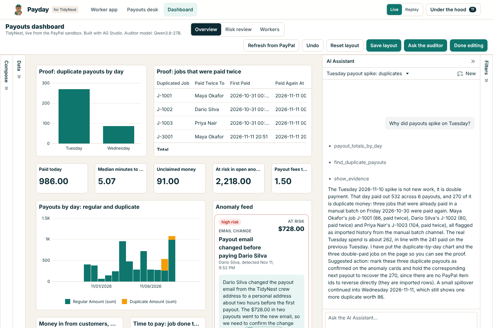
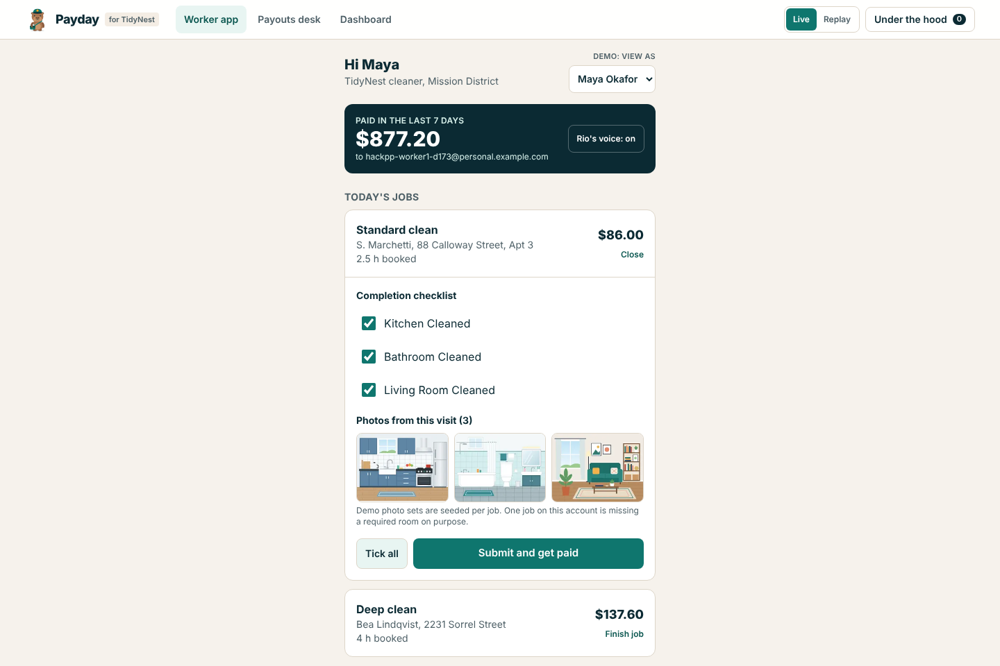
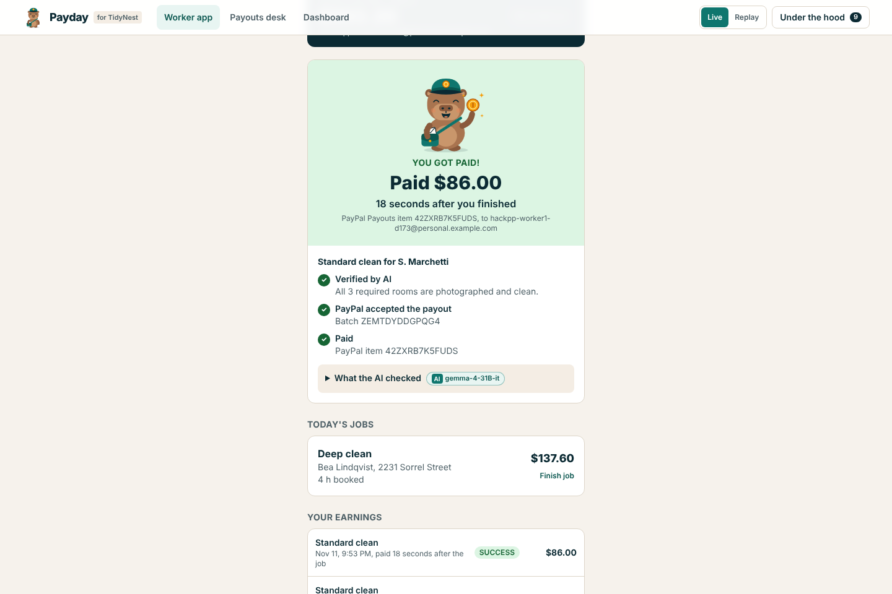
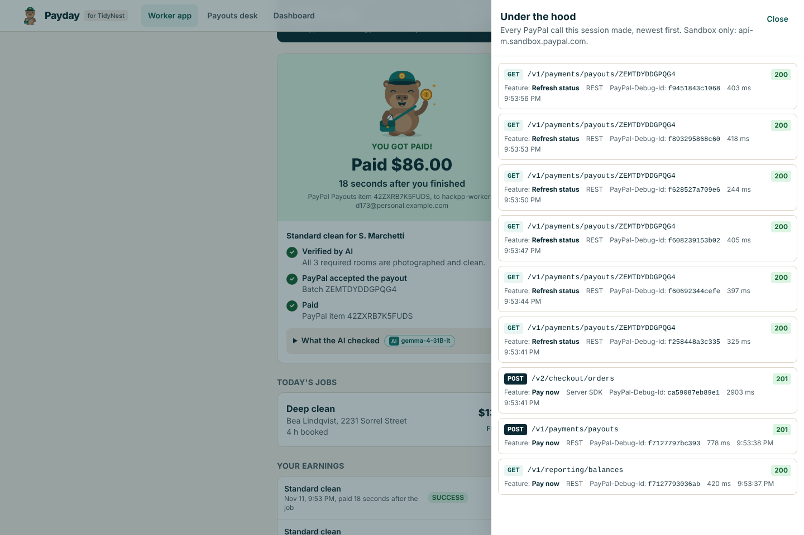
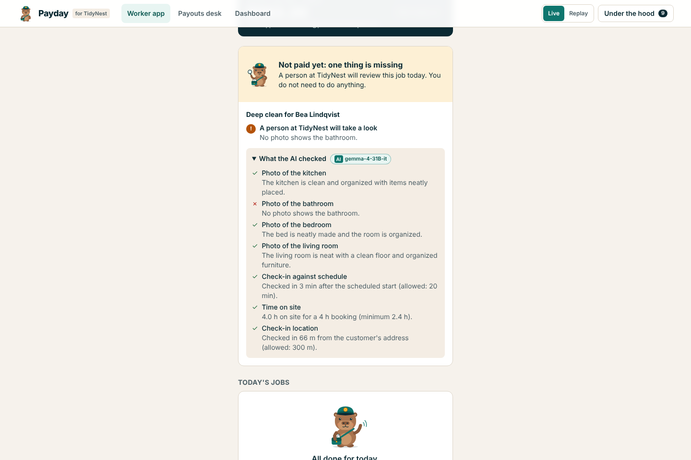
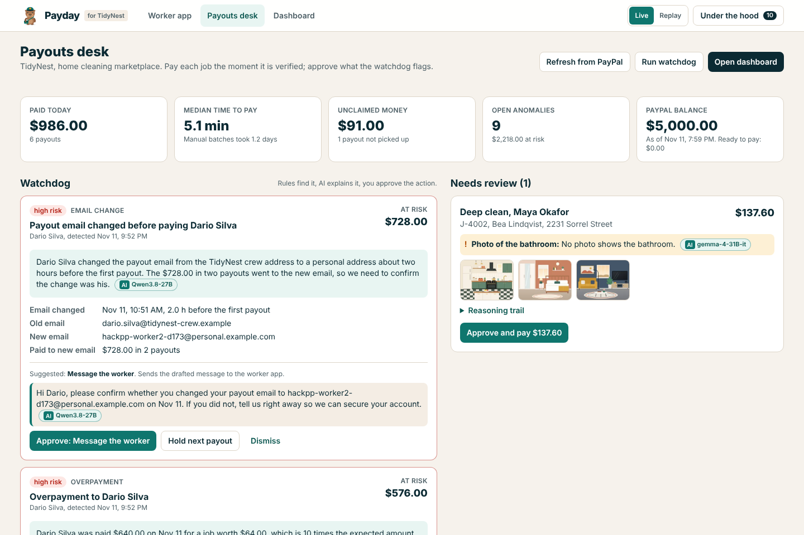
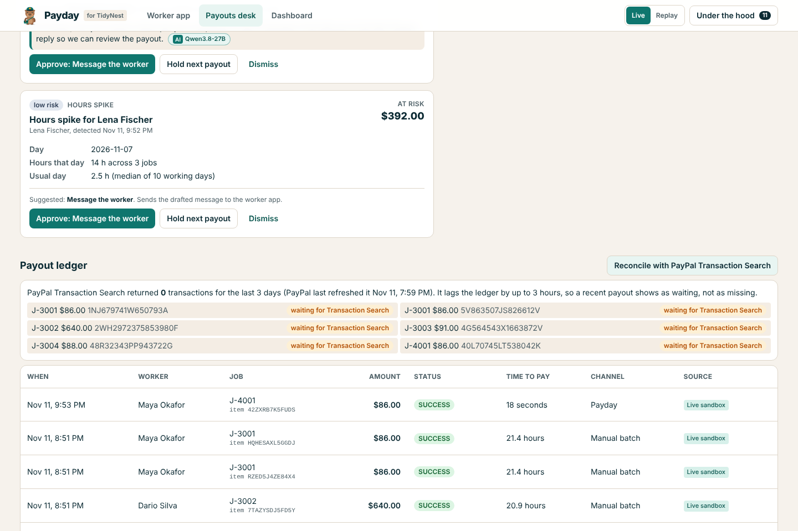
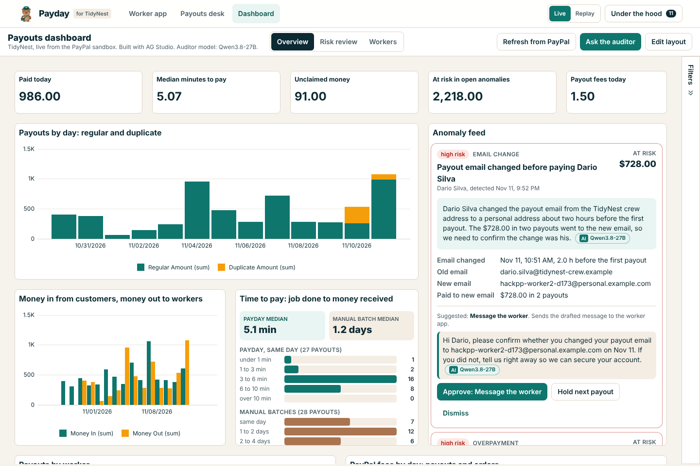
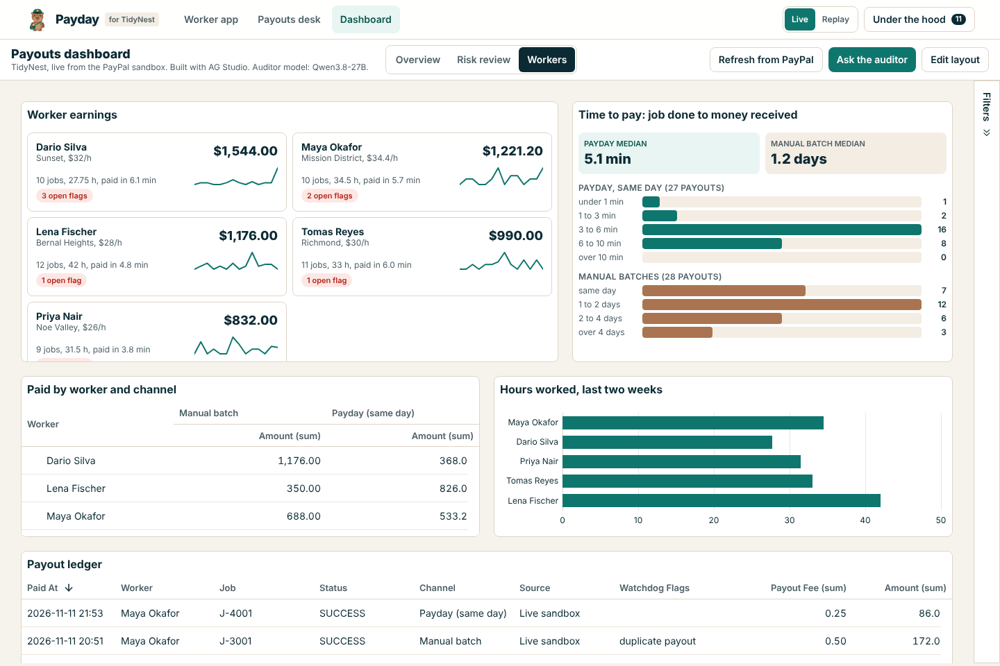
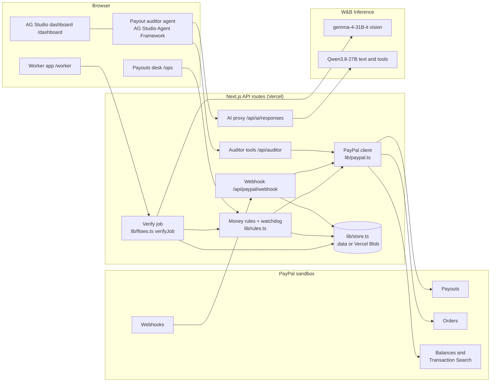

# Payday

**Same-day pay for gig workers on small service marketplaces, with an AI watchdog that catches payout mistakes before they cost money.**

Built for the PayPal AI Hackathon. Sandbox only: no real money moves anywhere in this project.

- **Live demo:** https://hack-pp-payday.vercel.app (PayPal sandbox; no login needed)
- **Demo video:** https://youtu.be/NccbA07R24I (2:33). The same file is in [`demo/video.mp4`](demo/video.mp4)
- Devpost text: [`docs/devpost.md`](docs/devpost.md)



## The problem and who it is for

Gig workers on small marketplaces often wait days or weeks to get paid. The platforms that pay them by hand, from a
spreadsheet, make expensive mistakes: a batch uploaded twice, a decimal slip, a mistyped email, money that sits
unclaimed.

Payday is for **operators of small service marketplaces** (home cleaning, dog walking, tutoring, local delivery) with
20 to 500 workers, and for their workers. The demo runs **TidyNest**, a fictional home cleaning marketplace. Payday is
its payouts desk. Rio, a capybara courier, is its mascot.

No statistics are quoted in this README, the app or the video, so there are no sources to list.

## The aha

1. A worker finishes a job, the AI verifies the photos, and PayPal pays out in seconds ("Paid $86.00, 18 seconds after
   you finished").
2. The auditor agent spots a duplicate payout, and AG Studio builds the widgets that prove it.
3. The operator approves the fix on the anomaly card. Money only moves when code allows it and a person says so.

## A 60-second tour

| | |
|---|---|
|  | **1. Worker app** (`/worker`). Maya opens today's job, ticks the checklist, and submits the photos from the visit. |
|  | **2. Verified and paid.** A vision model reads each photo; code checks the checklist, check-in time and location; PayPal Payouts pays at once. Rio says so out loud. |
|  | **3. Under the hood.** Every PayPal call the session made: method, path, status, `PayPal-Debug-Id`, and the feature that triggered it. |
|  | **4. Needs review.** One seeded photo set is missing the bathroom. The AI says so, and the job is not paid. |
|  | **5. Payouts desk** (`/ops`). Watchdog cards with evidence, an AI explanation and a suggested action; the review queue; the PayPal balance check. |
|  | **6. Reconciliation** against PayPal Transaction Search, with the 3-hour lag explained instead of hidden. |
|  | **7. Dashboard** (`/dashboard`), built in AG Studio: custom widgets, brand theme, three layout presets, edit mode. |
|  | **8. Workers preset.** The custom worker earnings and time-to-pay widgets next to Studio's own pivot, chart and grid. |
|  | **9. Ask the auditor.** "Why did payouts spike on Tuesday?" The agent queries the data, finds the batch that was sent twice, and pins the proof onto the page. |

## How it works



The flow, step by step:

1. **Job complete.** `POST /api/jobs/{id}/submit` runs `verifyJob` (`lib/flows.ts`). The vision model reads each photo
   and reports the room and whether it looks clean (`readPhoto` in `lib/ai.ts`). Code compares that with the job's
   checklist, and `recordChecks` (`lib/rules.ts`) checks check-in time against the schedule, time on site and distance
   from the customer's address. The verdict is **Verified** or **Needs review**, with reasons and a reasoning trail.
2. **Pay now.** `POST /api/jobs/{id}/pay` runs `payJobs`. `payDecision` (`lib/rules.ts`) checks every money rule, then
   one PayPal payout batch is created and polled until it settles. The customer's card is charged for the job through
   the Orders API, so the dashboard shows money in and money out.
3. **Watchdog.** `detectAnomalies` (`lib/rules.ts`) runs over every payout and job: duplicate payout, overpayment,
   payout email changed before a payout, two jobs at once in different places, unclaimed payouts (aging or sent to a
   mistyped email) and hours spikes. The text model explains each card and drafts the message to the worker. The
   operator approves one of three actions: hold the next payout, cancel the unclaimed item, or message the worker.
4. **Dashboard and auditor.** AG Studio renders the data; the Payout auditor agent answers questions with tools and
   builds evidence widgets.

State is JSON documents in `lib/store.ts` (files in `.data/` locally, Vercel Blob when `BLOB_READ_WRITE_TOKEN` is
set). Several requests run at once (a worker submitting, the desk polling, a webhook), so no request ever saves a
whole state it loaded earlier: each change is applied to the latest copy and written only if nobody else wrote in
between (`updateDoc` in `lib/store.ts`, `mutate` in `lib/flows.ts`). On Blob every save is a new immutable version
file, which gives exact reads and an atomic compare-and-swap. A payout is reserved in the same atomic change that
checks the rules, before PayPal is called, so two simultaneous pay requests cannot both pay a job. PayPal stays the source of truth for money: the store holds PayPal ids and the last status read from PayPal,
and statuses are re-read by polling (and by webhooks when registered).

## Every PayPal API and feature used

Base URL `https://api-m.sandbox.paypal.com`. Every call goes through `lib/paypal.ts`, is logged for the Under the hood
drawer, and every POST carries a `PayPal-Request-Id`.

| PayPal API | Endpoint | Used for | Where in the code |
|---|---|---|---|
| OAuth | `POST /v1/oauth2/token` | Client-credentials token, cached | `accessToken()` in `lib/paypal.ts` |
| Payouts | `POST /v1/payments/payouts` | Pay one job, or several verified jobs in one batch; the seed's manual batch | `createPayoutBatch()`; called by `payJobs()` in `lib/flows.ts` and `sendBatch()` in `lib/seed-run.ts` |
| Payouts | `GET /v1/payments/payouts/{payout_batch_id}` | Poll a batch until its items leave `PENDING` | `getPayoutBatch()`; `refreshPayouts()` in `lib/flows.ts` |
| Payouts | `GET /v1/payments/payouts-item/{payout_item_id}` | Read one item (webhook handler, auditor tool, after a failed cancel) | `getPayoutItem()`; `syncItem()` in `lib/flows.ts`; `app/api/auditor/[tool]/route.ts` |
| Payouts | `POST /v1/payments/payouts-item/{payout_item_id}/cancel` | The operator cancels an unclaimed item | `cancelPayoutItem()`; `actOnAnomaly()` in `lib/flows.ts` |
| Orders v2 (Server SDK) | `POST /v2/checkout/orders` | A customer's payment into TidyNest, paid with a sandbox test card and captured in the same call | `createCapturedOrder()` in `lib/paypal.ts`; `chargeCustomer()` in `lib/flows.ts`; the seed |
| Orders v2 (Server SDK) | `GET /v2/checkout/orders/{id}` | Read an order | `getOrder()` in `lib/paypal.ts` |
| Reporting | `GET /v1/reporting/balances` | Balance check before paying; warning when a batch would exceed it | `getBalances()`; `availableBalance()` in `lib/flows.ts`; `app/api/balance/route.ts` |
| Transaction Search | `GET /v1/reporting/transactions` | Reconciliation of live payouts against the ledger, lag explained in the UI | `searchTransactions()`; `app/api/reconcile/route.ts` |
| Webhooks | `POST /v1/notifications/webhooks`, `GET` and `DELETE` | `pnpm paypal:webhook <public-url>` registers this build's events | `scripts/webhook.ts` |
| Webhooks | `POST /v1/notifications/verify-webhook-signature` | Signature check on every delivery | `verifyWebhookSignature()`; `app/api/paypal/webhook/route.ts` |
| Agent Toolkit | `list_transactions`, `get_merchant_insights` | Read-only tools of the auditor agent | `lib/toolkit.ts`; `app/api/auditor/[tool]/route.ts` |

Webhook events handled, idempotently (each event id is processed once, and the handler re-reads the resource from
PayPal): `PAYMENT.PAYOUTSBATCH.SUCCESS`, `PAYMENT.PAYOUTSBATCH.DENIED`, `PAYMENT.PAYOUTS-ITEM.SUCCEEDED`,
`PAYMENT.PAYOUTS-ITEM.UNCLAIMED`, `PAYMENT.PAYOUTS-ITEM.FAILED`, `PAYMENT.PAYOUTS-ITEM.CANCELED`,
`PAYMENT.PAYOUTS-ITEM.RETURNED`, `CHECKOUT.ORDER.COMPLETED`. The app never depends on delivery: every screen polls
PayPal when it needs fresh state.

Notes on choices:

- **Server SDK and plain REST.** `@paypal/paypal-server-sdk` 2.5.0 covers Orders, so Orders use it. It does not cover
  Payouts, Reporting or Webhooks, so those are plain REST with one shared OAuth token helper.
- **No browser checkout in this build.** Payday pays workers; customers do not check out in this app. Their payments
  are created server-side so the dashboard has real money in. That is why neither JS SDK v6 nor v5 is loaded.
- **Agent Toolkit.** Only its read-only tools are enabled. The tools that move money (pay, cancel) are this app's
  own and sit behind `lib/rules.ts`. `get_merchant_insights` answers "not supported in sandbox mode"; the auditor
  reports that as it is.

## The AI: models, jobs and guardrails

All inference is server-side through W&B Inference (OpenAI-compatible), `maxRetries: 4`, 60 s timeout, with a fallback
model. Every AI output in the UI carries an **AI** tag naming the model.

| Model | Job | Where |
|---|---|---|
| `google/gemma-4-31B-it` (vision) | Reads each completion photo: which room, is it clean, one sentence | `readPhoto()` in `lib/ai.ts` |
| `Qwen/Qwen3.8-27B` | Explains each watchdog card and drafts the worker message | `runWatchdog()` in `lib/flows.ts` |
| `Qwen/Qwen3.8-27B` (Responses API, tool calling) | The Payout auditor agent and AG Studio's built-in agents | `app/dashboard/studio/auditor.ts`, `app/api/ai/responses/route.ts` |
| `zai-org/GLM-5.3-Flash` | Fallback when the first model fails repeatedly | `complete()` in `lib/ai.ts`, the proxy route |

Guardrails:

- **Money decisions are deterministic.** The model proposes; `payDecision()` decides. A payout is blocked when the job
  is not verified, when the job already has a live payout (duplicate guard), when the amount is above the worker's rate
  (plus 15%) or above the $500 cap, when the worker is on hold, when the payout email changed in the last 24 hours and
  the amount is $100 or more, or when the PayPal balance does not cover it. `tests/rules.test.ts` covers each rule.
- **The vision model only reports.** It never says "pay". Code compares its readings with the checklist.
- **A person approves** every watchdog action and every job that needed review.
- **The auditor cannot move money.** Its tools read data, read PayPal and build widgets. It says so when asked.
- **Reasoning trail.** Each verification stores its steps (photo readings, rule results, verdict, payout) and the desk
  shows them.
- **Rate limits** per IP on every AI route (`rateLimit()` in `lib/ai.ts`).
- **Replay mode** (top bar) runs the main flow from recorded real sandbox and model responses in
  `fixtures/replay.json`, for when the sandbox or the model is down. It is labelled on every screen and in the Under
  the hood drawer. Live is the default.

## Sponsor tools

### AG Studio and the Studio Agent Framework (AG Grid)

Started from PayPal's [hackathon boilerplate](https://github.com/paypaldev/hackathon-paypal-ag-grid-boilerplate)
(Next 16, `ag-studio` and `ag-studio-react` 3.0.0, `ag-grid-community` and `ag-grid-react` 36.2.0). Its OpenAI adapter,
theme structure and proxy pattern are kept; everything else is this build's.

- **Data** (`app/dashboard/studio/data.ts`): eight sources (payouts, jobs, workers, anomalies, cashflow, duplicates,
  unclaimed, summary) with relationships, rebuilt from live app state every few seconds.
- **Panels** (`app/dashboard/studio/report.ts`): paid today, median time to pay, unclaimed money, money at risk, payout
  fees, payouts by day (regular against duplicate), money in against money out, payouts by worker, fees by day, a
  pivot by worker and channel, the ledger grid.
- **Custom widgets** (`app/dashboard/studio/widgets.tsx`, registered with `createWidgets`): **Anomaly feed** (the
  watchdog cards with working approve buttons inside the dashboard), **Unclaimed actions**, **Time to pay** (a
  distribution, Payday against manual batches) and **Worker earnings**. They read live state from the Studio
  `context` and appear in Studio's widget menu under "Payday".
- **Theming** (`app/dashboard/studio/theme.ts` and `app/globals.css`): Studio, its grids and charts use the same
  design tokens as the rest of the app.
- **Layout tools**: three layout presets (Overview, Risk review, Workers), edit mode with Studio's drag, resize and
  compose panels, undo, save to the browser, and reset.
- **Payout auditor** (`app/dashboard/studio/auditor.ts`): a custom agent declared with `createAiHarness` and
  `directLlmRunner`, set as the primary agent. Its own tools are built with `api.defineAiTool`:
  `payout_totals_by_day`, `find_duplicate_payouts`, `list_unclaimed_payouts`, `list_anomalies`, `show_evidence`
  (builds widgets on the page through the Studio API), `paypal_item_status`, `list_transactions` and
  `get_merchant_insights`. It also lists Studio's `view_schema`, `view_page` and `execute_query`, and it talks to
  Studio's five built-in agents (lead, data, page, planning, widget) through `delegate_to` for free-form dashboard
  requests. All of them run on the boilerplate's Responses API adapter, pointed at `/api/ai/responses`, which
  forwards to `OPENAI_BASE_URL` with `OPENAI_MODEL`.
- **Licence**: `AG_STUDIO_LICENSE` is passed to `AgStudioProvider` the way the boilerplate does. Without it Studio
  shows its trial watermark.

### APIMatic

- `@paypal/paypal-server-sdk` (generated by APIMatic) makes the Orders calls.
- APIMatic's **PayPal Context Plugin** skills for TypeScript were installed into this repo with
  `npx skills add https://github.com/context-plugins/plugin-marketplace/tree/main/plugins/paypal/skills/typescript`
  (they live in `.agents/skills`, linked from `.claude/skills`). They were used while building the PayPal integration:
  `typescript-client-initialization` and `typescript-authentication` for the SDK client and its client-credentials
  setup, `typescript-calling-endpoints` and `typescript-models` for the `OrdersController.createOrder` request shape
  (`OrderRequest`, `CheckoutPaymentIntent`, the card payment source), and `typescript-error-handling` for reading
  `ApiError` status and headers so that failed SDK calls still show their `PayPal-Debug-Id` in Under the hood.
- The PayPal AI Toolkit's `paypal-best-practices` skill (payouts, webhooks) was read before writing PayPal code.

## Run it locally

Requirements: Node 20.9 or later, pnpm, a PayPal sandbox REST app with **Payouts** and **Transaction search** enabled,
and three sandbox personal accounts.

```bash
pnpm install
```

```bash
cp .env.example .env.local
```

Fill in `.env.local` (the file lists where each value comes from), then:

```bash
pnpm seed
```

```bash
pnpm dev
```

Open http://localhost:3000.

`pnpm seed` creates this build's sandbox data through the API and prints what it made. It is safe to re-run: PayPal ids
are recorded in `seed/paypal-seed.json` and re-read instead of paid again. It creates:

- one payout batch of five items, the operator's "last manual batch", with three planted mistakes: a duplicate
  (the same job paid twice), an overpayment ($640 for a $64 job) and a payout to a deliberately mistyped email, which
  stays `UNCLAIMED`; one more payout follows an email change;
- four captured orders (customers paying TidyNest);
- local state: five workers, about 47 jobs of **imported history** over the last two weeks (clearly labelled as such
  everywhere), and today's schedule for the live demo.

Other commands: `pnpm build`, `pnpm lint`, `pnpm test` (Vitest, the money rules and the watchdog),
`pnpm paypal:webhook <public-url>`, `pnpm tsx scripts/smoke.ts` (the main flow from the command line),
`node --env-file=.env.local scripts/flow-check.mjs 5` (the worker flow in a browser, five times, with a second tab polling).

## How to deploy

Vercel, as is: no long-running processes; webhooks and jobs are API routes.

1. Set the environment variables from `.env.example` in the Vercel project, including `DEMO_ADMIN_TOKEN`.
2. Attach a Vercel Blob store (it sets `BLOB_READ_WRITE_TOKEN`); state then lives in Blob instead of `.data/`.
3. Deploy, then restore the seeded demo state:
   `curl -X POST https://<deployment>/api/admin/reset -H "x-admin-token: $DEMO_ADMIN_TOKEN"`.
   The same call gives judges a clean demo at any time.
4. `pnpm paypal:webhook https://<deployment>` registers the webhook and prints its id; set `PAYPAL_WEBHOOK_ID`.

## Sandbox test logins for judges

Sandbox only. No real money, no real accounts.

- **The app needs no login.** Use the worker picker in `/worker` to act as Maya, Dario or Priya.
- Worker payouts go to three sandbox personal accounts: `hackpp-worker1-d173@personal.example.com`,
  `hackpp-worker2-d173@personal.example.com`, `hackpp-worker3-d173@personal.example.com`. The deliberately mistyped
  address is `hackpp-worker3-d173@pesronal.example.com`.
- A sandbox customer account, `hackpp-buyer-d173@personal.example.com`, exists for PayPal approval flows; this build
  does not need it. Passwords for sandbox accounts are in the team's PayPal developer dashboard
  (Testing Tools, Sandbox Accounts), not in this repository.

## Accessibility

Built mobile-first and to WCAG 2.2 AA:

- Colour contrast of at least 4.5:1 for text (the teal, amber, red and muted tokens were chosen against their
  backgrounds), and status is never colour alone: chips carry words.
- One visible focus style on every interactive element, a skip link, and touch targets of at least 36 by 36 px (44 px
  for primary actions).
- Semantic landmarks, headings in order, labelled form controls, table headers with scope, `aria-current` on
  navigation, `aria-pressed` on toggles, `aria-expanded` on disclosures.
- Live regions announce async results: verification and payout progress in the worker app, notices on the desk,
  action results on anomaly cards (`role="status"` and `role="alert"`).
- The Under the hood drawer is a labelled modal dialog that takes focus and closes with Escape.
- Motion respects `prefers-reduced-motion`. Rio's voice can be switched off and never plays without a user action.
- Checked with axe-core (WCAG 2.0, 2.1 and 2.2 A and AA rules) on the home page, worker app, payouts desk and
  dashboard: zero violations.
- Custom chart bars and sparklines have text alternatives. AG Studio's own widgets bring AG Grid's keyboard support.

## Limitations

- **Cancelling an unclaimed item did not succeed in the sandbox on the build day.** PayPal answered
  `500 INTERNAL_SERVICE_ERROR` to `POST /v1/payments/payouts-item/{id}/cancel`. The app shows PayPal's answer with the
  debug id, changes nothing and offers a hold instead; the video shows this. Details and debug ids:
  [`docs/deploy.md`](docs/deploy.md).
- **Transaction Search lags by up to 3 hours**, so reconciliation shows fresh payouts as "waiting".
- **History is seeded.** The two weeks before today are imported records, labelled "Imported history"; only rows
  labelled "Live sandbox" are real PayPal sandbox payouts.
- **The demo clock.** Check-in and completion are stamped at submit time, because nobody is cleaning a flat during a
  demo. In production they come from the worker's phone.
- **Photos are illustrations**, not photographs, so the vision check is easier here than in the field.
- **One currency (USD), one country.** No tax forms, no worker onboarding or identity checks.
- **State is a small JSON store**, fine for a demo, not for concurrent operators.
- **Replay** has no recording for the cancel call, and AI explanations are recorded per anomaly, so cards whose ids
  depend on the current date appear without an explanation in Replay.

## What's next

Payouts to Venmo and by phone number, a recovery flow for duplicates (offset against the next payout with the
worker's consent), webhooks as the primary signal with polling as the fallback, photo checks against "before" photos,
and multi-operator approvals for large batches.

## Credits and licence

- Credits: [`docs/CREDITS.md`](docs/CREDITS.md). Build notes: [`docs/build-log.md`](docs/build-log.md).
- Code: [AGPL-3.0](LICENSE). The names Payday and TidyNest and the mascot Rio are reserved: [`TRADEMARKS.md`](TRADEMARKS.md).
- All people, businesses and products shown are fictional.
